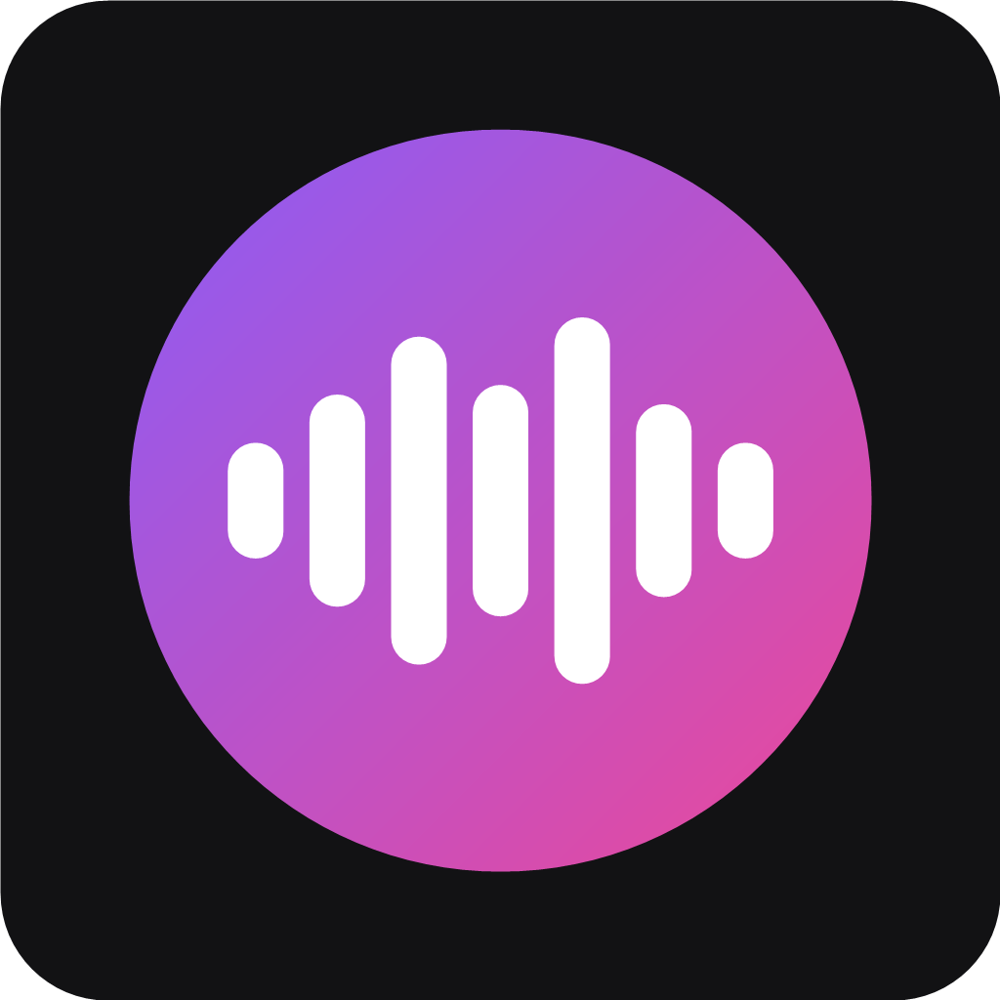

<div align="center">



# HiFi Player

### Bit-perfect music player for Windows

*An audiophile player that sends your music to the DAC exactly as it was recorded: native DSD over ASIO, WASAPI Exclusive, gapless playback, a fast music library and Spotify Connect, in a clean Roon-style interface.*

<br />

[](../../releases)
[](LICENSE)
[](#-download)
<br />
[](src)
[](app)

<br />

[📥 Download](#-download) • [✨ Key Features](#-key-features) • [🎧 Signal Path](#-signal-path) • [🟢 Spotify Connect](#-spotify-connect) • [📱 Remote](#-remote-control) • [🛠️ Build from Source](#️-build-from-source) • [🤝 Contributing](#-contributing) • [⚖️ Legal Notice](#️-legal-notice)

</div>

> [!IMPORTANT]
> **HiFi Player** is an independent, free and open-source project. It is not affiliated with, endorsed by, or sponsored by Steinberg, Spotify, Qobuz or TIDAL. Spotify Connect support uses the unofficial [librespot](https://github.com/librespot-org/librespot) library and requires Spotify Premium.

---

## ✨ Key Features

<table>
<tr>
<td width="50%" valign="top">

### 🎧 Audiophile Playback
- **Bit-perfect output:** ASIO (direct driver access) and WASAPI Exclusive bypass the Windows mixer. No resampling, no volume or EQ processing, ever.
- **Native DSD:** DSD64 up to DSD512 straight to the DAC over ASIO, with DoP and DSD→PCM fallbacks for other DACs.
- **True gapless:** consecutive tracks in the same format play through one uninterrupted stream.
- **Locked pause:** the DAC stays locked on silence while paused, so there are no clicks or relocks.
- **DST, SACD ISO, cue sheets and MQA display**, plus a bit-perfect self-test and the DAC's real locked rate.
- **Audio analysis:** DR, LUFS and detection of fake hi-res (upsampled or MP3-sourced) files.

</td>
<td width="50%" valign="top">

### 📚 Music Library
- **Fast scanning:** thousands of tracks in seconds; rescans only read changed files.
- **Smart grouping:** compilations, "feat." artists and untagged `Artist - Album` folders are sorted out automatically.
- **Cover art:** embedded artwork or `folder.jpg` / `cover.jpg`.
- **Formats:** FLAC, ALAC, WAV, AIFF, DSF, DFF, MP3, AAC, Ogg Vorbis.
- **Playlists, favourites, ratings and history**, radio mixes, similar albums and "On this day".
- **Online extras (optional):** missing covers and artist bios, ListenBrainz / Last.fm scrobbling, Discord status.

</td>
</tr>
<tr>
<td width="50%" valign="top">

### 🎨 Interface
- **Album grid:** Roon-inspired dark theme with DSD / Hi-Res / CD filters.
- **Library pages:** album and artist pages, instant search, queue management.
- **Now Playing:** full-screen view plus a bar with a seek bar and a quality badge.
- **Themes:** dark, light, black (OLED) and midnight, accent colours and colours from the cover art.
- **TV mode, mini player, synced lyrics and a tag editor.**
- **Live VU / peak meters and spectrum, waveform seek bar and spectrograms** (display only).
- **Keyboard:** Space to play/pause, Alt+← to go back.

</td>
<td width="50%" valign="top">

### 🟢 Streaming & Remote
- **Spotify Connect:** pick "HiFi Player" as a speaker in any Spotify app; it plays through the same ASIO / WASAPI output.
- **Phone remote:** a browser remote on your Wi-Fi (scan a QR code, enter the PIN) with now playing, transport, queue and album browsing.
- **Lossless internet radio:** Radio Paradise FLAC and more, played bit-perfect.
- **AirPlay:** iPhones, iPads and Macs can play through HiFi Player.
- **DLNA / UPnP:** play from phone and NAS apps through HiFi Player, or share your library with TVs and streamers.
- **Qobuz & TIDAL:** screens for users who have partner API access.

</td>
</tr>
</table>

---

## 📥 Download

Get the latest installer from the **[Releases page](../../releases)**: `HiFi Player_x.y.z_x64-setup.exe`.

The setup wizard lets you install for just you or for all users, choose the folder, and add Start menu and desktop shortcuts. The app updates in place when you install a newer version.

**Requirements:** Windows 10 or 11 (64-bit). For native DSD you need a DAC whose ASIO driver supports DSD (e.g. iFi, XMOS/Thesycon-based DACs).

> [!TIP]
> There is **no volume control in HiFi Player**, because a bit-perfect stream can't have one. Set the level on your DAC or amplifier, and start low.

---

## 🎧 Signal Path

Click the quality badge in the Now Playing bar to see exactly what reaches your DAC:

| Dot | Meaning |
|---|---|
| 🟣 Purple | **Bit-perfect**: the source reaches the DAC untouched (PCM, native DSD, or DoP) |
| 🟢 Green | **High quality, converted**: e.g. DSD→PCM for a DAC without DSD support |
| 🟡 Yellow | **Lossy source**: MP3, AAC, Ogg (including Spotify) |

Example: `DSF · DSD128 → None (native DSD128) → ASIO · iFi USB Audio Device · Native DSD 5.6448 MHz`

---

## 🟢 Spotify Connect

1. In HiFi Player open **Spotify** in the sidebar and click **Log in with Spotify**. You log in on Spotify's own page in your browser.
2. Open Spotify on your phone or PC, tap the **devices** icon and choose **HiFi Player**.
3. The music plays through HiFi Player's output to your DAC, and the track, cover and controls appear in the app.

Spotify sends Ogg Vorbis at 320 kbps to Connect devices; lossless is not available to third-party devices. Your login is stored encrypted with Windows DPAPI.

---

## 📱 Remote Control

1. In HiFi Player go to **Settings → Remote control** and click **Turn on remote**. The first time, Windows asks whether to allow HiFi Player on your network: allow it for **private networks**.
2. On your phone, on the same Wi-Fi, scan the QR code (or type the address shown) and enter the 6-digit **PIN**.
3. Control playback, browse albums and manage the queue. Add the page to your home screen for one-tap access.

The remote only sends commands; the music still plays from the PC straight to your DAC. It is off by default, and **New PIN** locks out phones that used the old one.

---

## 🛠️ Build from Source

**Requirements:** Rust (MSVC toolchain), Visual Studio C++ Build Tools, Node.js 20+.

```powershell
git clone https://github.com/ashenjay/hifiplayer.git
cd hifiplayer\app
npm install
npx tauri build      # installer: target\release\bundle\nsis\
npx tauri dev        # run with hot reload
```

The playback engine also comes with a command-line player:

```powershell
cargo run --release -- devices
cargo run --release -- play --output asio --device iFi "D:\Music\Album"
cargo test --workspace
```

<details>
<summary><b>Project layout</b></summary>

| Path | Contents |
|---|---|
| `src/source/` | Decoding (symphonia), DSF/DFF readers, HTTP streams |
| `src/dsd/` | DoP packing and DSD→PCM conversion |
| `src/output/` | WASAPI Exclusive and ASIO (`asio/ffi.rs` is the raw driver interface) |
| `src/engine.rs` | Playback path selection, fallbacks, gapless decoding |
| `src/player.rs` | Queue and transport |
| `src/library/` | Library database, folder scanning, tag reading |
| `src/spotify.rs` | Spotify Connect receiver (librespot) |
| `src/streaming/` | Qobuz and TIDAL |
| `app/` | Desktop app: Tauri 2 + React + TypeScript |

</details>

<details>
<summary><b>Releasing a new version</b></summary>

Versions follow [Semantic Versioning](https://semver.org): `1.0.1` for bug fixes, `1.1.0` for new features.

1. `powershell -File scripts\bump-version.ps1 1.0.1` sets the version everywhere.
2. Add the changes to [CHANGELOG.md](CHANGELOG.md).
3. If dependencies changed: `powershell -File scripts\third-party-notices.ps1`.
4. Commit and `git push origin main`.
5. On GitHub, go to **Actions → Release → Run workflow** and enter the version. The workflow builds the installer and creates a draft release. Review it and publish.

</details>

---

## 🤝 Contributing

Bug reports and ideas are welcome! Please use the **[issue forms](../../issues/new/choose)**. They ask for your version, DAC/driver and output type, which makes problems much easier to reproduce. Pull requests should keep playback bit-perfect: DSP features such as volume, EQ or resampling are out of scope.

---

## ⚖️ Legal Notice

HiFi Player is free software: you can redistribute it and/or modify it under the terms of the **[GNU General Public License v3.0](LICENSE)**. It comes with **absolutely no warranty**. Third-party components and their licences are listed in [THIRD_PARTY_NOTICES.md](THIRD_PARTY_NOTICES.md).

ASIO is a trademark of Steinberg Media Technologies GmbH. Spotify, Qobuz and TIDAL are trademarks of their respective owners. HiFi Playerâ„¢ is not affiliated with or endorsed by any of them. Use streaming services in line with their terms of service.

<div align="center">
<br />
<sub>Made for people who care about every bit.</sub>
</div>
